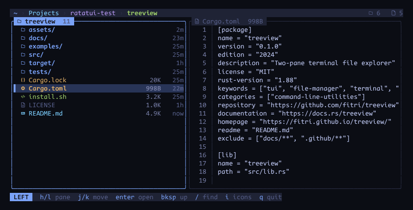

# treeview

**A two-pane file explorer for the terminal.** Browse on the left, preview on the
right — no configuration file, no runtime, one static binary.

[](https://github.com/fitri/treeview/actions/workflows/ci.yml)
[](https://github.com/fitri/treeview/releases)
[](LICENSE)



The left pane lists the directory you are in; the right previews whatever is
highlighted — a folder's contents, or the first 100 lines of a file. Built on
[ratatui](https://ratatui.rs).

## Features

- **Two live panes.** Both are navigable. `enter` on either pane promotes that
  folder to the left, so you can walk a tree without ever going back.
- **Previews that stay out of the way.** Directories, text files with line
  numbers, and a short notice for binaries and special files instead of dumping
  bytes into your terminal.
- **Filter as you type.** `/` narrows the focused pane live; `enter` keeps the
  filter, `esc` brings the full list back.
- **Colour by file type.** A per-extension palette and Nerd Font icons. Press
  `i` for a plain ASCII layout on terminals without the font.
- **Safe by construction.** Control characters are stripped before rendering,
  and FIFOs and devices are never opened — see [Safety](#safety).
- **Small.** A ~620 KB static binary that starts instantly and reads no config.

## Install

```sh
curl -fsSL https://raw.githubusercontent.com/fitri/treeview/main/install.sh | sh
```

Installs a prebuilt binary into `~/.local/bin` — override with
`PREFIX=/usr/local/bin`. If there is no release for your platform it falls back
to building from source with cargo.

Prebuilt for **Linux** (x86_64, aarch64 — fully static) and **macOS** (Intel,
Apple silicon). It also compiles on Windows with `cargo install --git`, though it
has only been exercised on Unix.

Other ways in:

```sh
cargo install --git https://github.com/fitri/treeview   # from source
cargo build --release                                   # from a checkout
```

## Keys

| Key | Action |
| --- | --- |
| `h` `l` | move focus between the left and right pane |
| `j` `k` | move the cursor inside the focused pane |
| `enter` | open the highlighted directory — it becomes the left pane |
| `bksp` / `-` | go up one level (re-selects the directory you came from) |
| `/` | filter the focused pane, live |
| `enter` in search | keep the filter and go back to the pane |
| `esc` in search | clear the filter and show everything |
| `esc` | clear a filter, or quit when there is none |
| `g` / `G` | jump to the first / last entry |
| `.` | toggle dotfiles |
| `r` | reload both panes |
| `d` / `u`, `PgDn` / `PgUp` | scroll a text preview |
| `i` | toggle Nerd Font icons / plain ASCII |
| `q` | quit |

## Colour and icons

A Tokyo-Night-ish palette, chosen per file type:

| | |
| --- | --- |
| directories | blue, bold, outline folder |
| Rust | orange, gear |
| markdown / text | cyan, document |
| config (toml, yaml, json…) | yellow |
| code (py, js, go, sh…) | green, `</>` |
| images | magenta, image |
| archives · pdf · binaries | orange / red |
| symlinks | magenta, link |

Icons need a **Nerd Font on the machine you view from** (verified against
CodeNewRoman Nerd Font Mono). Without one, press `i` and everything falls back to
a plain two-column layout. Size and age columns appear only when the pane is wide
enough, so narrow terminals stay readable.

## Safety

Browsing a directory you did not create — a downloaded tarball, a shared mount —
should never be able to hurt your terminal.

- **No escape-sequence injection.** File names, the highlighted path, the filter
  query and file contents all pass through ratatui's `Buffer`, which drops
  control characters (C0, DEL, C1) before anything reaches the terminal. A file
  named `pwn<ESC>[2J.txt` renders as inert text. Verified at the byte level.
- **Special files are never opened.** A FIFO with no writer, or `/dev/ptmx`,
  would block `open(2)` forever and freeze the event loop; previews are limited
  to regular files.
- **Reads are bounded:** 128 KiB per file, 100 preview lines, 20 000 entries per
  listing.
- No network, no shell-outs, no `unsafe`.

## Limitations

- A single directory listing is capped at 20 000 entries (the pane title shows a
  trailing `+`). Without the cap a million-file directory took ~50 s and ~700 MB.
- Listings are synchronous: moving the cursor re-reads the highlighted directory.
  On a normal project that is well under a millisecond; on `/usr/bin` (1 200
  entries) it is about 10 ms per move. A cache would need careful invalidation
  (`r`, `.`, external changes), so there isn't one.
- No syntax highlighting in the preview, no `$EDITOR` integration, no file
  operations — it is a viewer.

## Development

```
src/theme.rs   palette, icons, per-extension colours
src/fs.rs      read directories, build previews (no UI types)
src/app.rs     state: two panes, filter, focus, key handling
src/ui.rs      rendering; a pure function of App
src/main.rs    terminal setup + the event loop
examples/preview.rs  render to stdout, no terminal needed
tests/render.rs      headless tests against a temp directory
```

```bash
cargo run                                            # start in the current directory
cargo test                                           # headless UI tests
cargo run --example preview -- . 100 24 "jjl/src"    # screenshot as text
```

The `preview` example accepts a key sequence after the path — plain characters
are typed, `<enter>` `<esc>` `<bs>` `<up>` `<down>` `<tab>` are recognised. It is
the fastest way to see what a change did without a terminal.

Releases are built by CI: pushing a `v*` tag produces static Linux and macOS
binaries via GitHub Actions.

## License

MIT — see [LICENSE](LICENSE).
