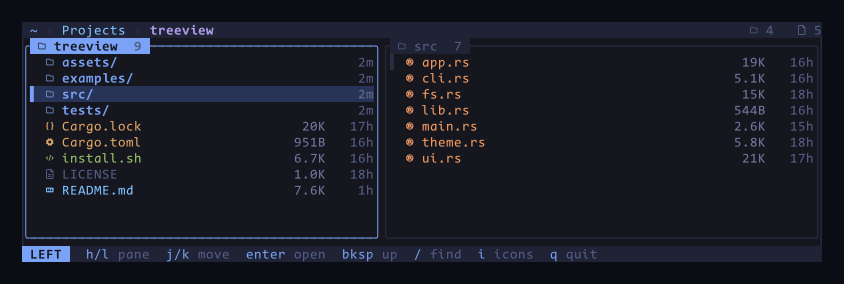

<h1 align="center">treeview</h1>

<p align="center">
  <strong>A two-pane file explorer for the terminal.</strong> Browse on the left,
  preview on the right. Read-only by design, so it is safe to point at a
  directory you did not create.
</p>

<p align="center">
  <a href="https://github.com/fitri/treeview/actions/workflows/ci.yml"></a>
  <a href="https://github.com/fitri/treeview/releases"></a>
  <a href="LICENSE"></a>
</p>

<p align="center">
  
</p>

<p align="center">
  The left pane lists the directory you are in; the right previews whatever is
  highlighted — a folder's contents, or the first 100 lines of a file. Built on
  <a href="https://ratatui.rs">ratatui</a>.
</p>

## Features

- **Two live panes.** Both are navigable. `enter` on either pane promotes that
  folder to the left, so you can walk a tree without ever going back.
- **Previews that stay out of the way.** Directories, text files with line
  numbers, and a short notice for binaries and special files instead of dumping
  bytes into your terminal.
- **Filter as you type.** `/` narrows the focused pane live; `enter` keeps the
  filter, `esc` brings the full list back.
- **Yank a path.** `y` copies the highlighted path, in either pane. It goes out
  as an OSC 52 sequence rather than through `pbcopy` or `wl-copy`, so it works
  over SSH too.
- **Colour by file type.** A per-extension palette and Nerd Font icons. Press
  `i` for a plain ASCII layout on terminals without the font.
- **Read-only by design.** It never writes, moves, renames or deletes, and it
  opens only regular files — see [Safety](#safety).
- **Small.** A 610 KB binary (713 KB with the static musl build) that starts
  instantly and reads no config.

<p align="center">
  
  <br>
  <sub><code>enter</code> descends into a folder, <code>/</code> filters the listing, <code>.</code> reveals dotfiles</sub>
</p>

## Install

```sh
curl -fsSL https://raw.githubusercontent.com/fitri/treeview/main/install.sh | sh
```

Puts a prebuilt binary in `~/.local/bin`; `PREFIX=/usr/local/bin` overrides that,
and the script warns you if the directory is not on your `PATH`. The archive is
checked against the release's `.sha256` whenever one is published (v0.1.1
onward).

Prebuilt for **Linux** (x86_64, aarch64 — fully static) and **macOS** (Intel,
Apple silicon). Anywhere else, Windows included, build from source:

```sh
cargo install --git https://github.com/fitri/treeview
```

## Start

```sh
treeview              # the current directory
treeview ~/Projects   # a directory you name
treeview ~/.bashrc    # its parent, with the file under the cursor
```

The path is optional, and with none it opens the current directory. Given a file
it opens the parent and puts the cursor on it — a terminal cannot list a file.
A path that does not exist is reported and exits non-zero, rather than opening an
empty pane.

`treeview --help` prints the keys, `treeview --version` the version, and `--`
ends option parsing for a path that begins with a dash.

## Keys

Vim keys, with the arrow keys working wherever `h` `j` `k` `l` do.

| Key | Action |
| --- | --- |
| `h` `l` | move focus between the panes (the right one only when it lists a directory) |
| `j` `k` | move the cursor inside the focused pane |
| `enter` | open the highlighted directory — it becomes the left pane |
| `bksp` / `-` | go up one level (re-selects the directory you came from) |
| `g` / `G` | jump to the first / last entry |
| `/` | filter the focused pane, live |
| `enter` in search | keep the filter and go back to the pane |
| `esc` in search | clear the filter and show everything |
| `esc` | clear a filter, or quit when there is none |
| `.` | toggle dotfiles |
| `r` | reload both panes |
| `y` | copy the highlighted path to the clipboard |
| `d` / `u`, `PgDn` / `PgUp` | scroll a text preview |
| `i` | toggle Nerd Font icons / plain ASCII |
| `q` | quit |

`ctrl-c` quits from anywhere. The window needs to be at least 24×6, and the
palette assumes a truecolour terminal.

## Colour and icons

Chosen per file type, Tokyo-Night-ish:

| Kind | Colour · icon |
| --- | --- |
| directories | blue · outlined folder |
| Rust | orange · gear |
| Python | yellow |
| code (js, ts, go, c, sh…) | green · `</>` |
| markdown / text | cyan · document |
| config (toml, yaml, json, env…) | yellow |
| images, video | magenta · image / film |
| archives | orange · box |
| pdf, binaries, keys | red |
| symlinks | magenta · link |

Icons need a **Nerd Font on the machine you view from** (verified against
CodeNewRoman Nerd Font Mono). Without one, press `i` and everything falls back to
a plain two-column layout. Size and age appear only when the pane is wide enough,
so narrow terminals stay readable.

## Safety

Browsing a directory you did not create — a downloaded tarball, a shared mount —
should never be able to hurt your terminal.

- **No escape-sequence injection.** File names, the highlighted path, the filter
  query and file contents all pass through ratatui's `Buffer`, which drops
  control characters (C0, DEL, C1) before anything reaches the terminal. A file
  named `pwn<ESC>[2J.txt` renders as inert text.
- **Special files are never opened.** A FIFO with no writer, or `/dev/ptmx`,
  would block `open(2)` forever and freeze the event loop; previews are limited
  to regular files.
- **Reads are bounded:** 128 KiB per file, 100 preview lines, 20 000 entries per
  listing.
- No network, no shell-outs, no `unsafe`.

## Limitations

- A directory listing is capped at 20 000 entries; a trailing `+` in the pane
  title says so. A directory previewed on the right shows its first 200 rows.
  Uncapped, a million-file directory took ~50 s and ~700 MB.
- Listings are synchronous: moving the cursor re-reads the highlighted directory.
  On a normal project that is well under a millisecond; on `/usr/bin` (1 200
  entries) it is about 10 ms per move. A cache would need careful invalidation
  (`r`, `.`, external changes), so there isn't one.
- No syntax highlighting in the preview, no `$EDITOR` integration, no file
  operations — it is a viewer.

## Update

Re-run the same command. It replaces the binary in place and tells you what it
did; if you are already on the latest release it stops without downloading
anything.

```sh
# again, as-is — or pin a release:
curl -fsSL https://raw.githubusercontent.com/fitri/treeview/main/install.sh | sh
curl -fsSL https://raw.githubusercontent.com/fitri/treeview/main/install.sh | VERSION=v0.1.0 sh
```

`FORCE=1` after the pipe reinstalls even when the version already matches. A
cargo install updates with `cargo install --git https://github.com/fitri/treeview --force`.

## Development

Three direct dependencies and no build script. The source is small enough to read
in an afternoon: `app.rs` holds the state and key handling, `fs.rs` reads
directories and builds previews, `ui.rs` draws (a pure function of `App`),
`theme.rs` is the palette, and `cli.rs` parses arguments. The tests drive the
real renderer against a temporary directory.

```bash
cargo run                                            # start here
cargo test                                           # headless UI tests
cargo build --release                                # the binary, at target/release/treeview
cargo run --example preview -- . 100 24 "jjl/src"    # screenshot as text
```

The `preview` example renders a single frame to stdout, so it needs no terminal,
and takes a key sequence after the path: plain characters are typed, `<enter>`
`<esc>` `<bs>` `<up>` `<down>` `<tab>` are recognised. It is the quickest way to
see what a change did.

Releases are built by CI: pushing a `v*` tag produces the static Linux and macOS
binaries.

Issues and pull requests are welcome. A bug report with the output of
`treeview --version`, your `$TERM` and the terminal emulator saves a round-trip —
there is a template for it.

## License

MIT — see [LICENSE](LICENSE).
